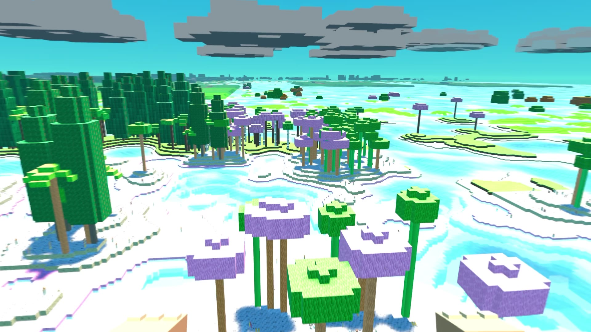
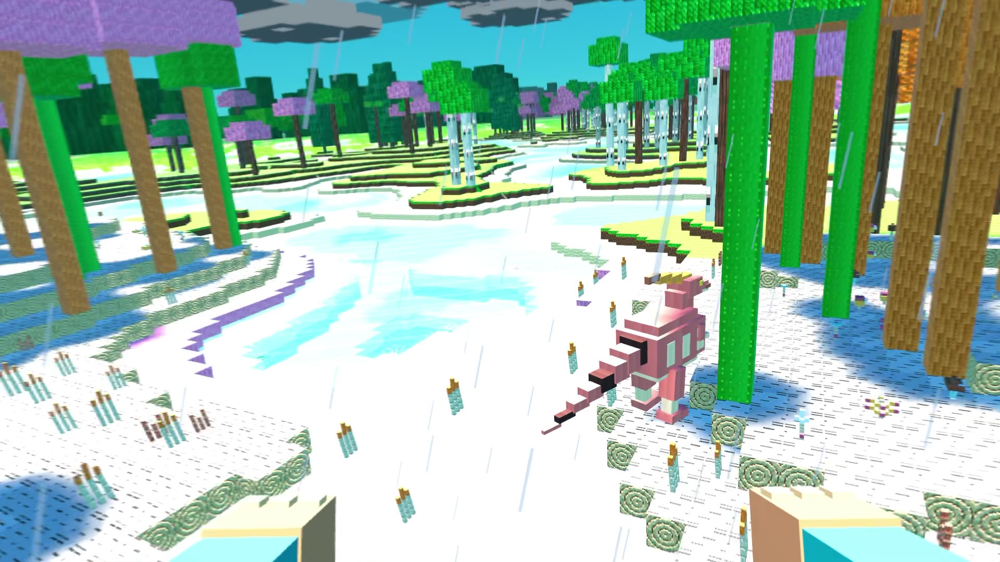
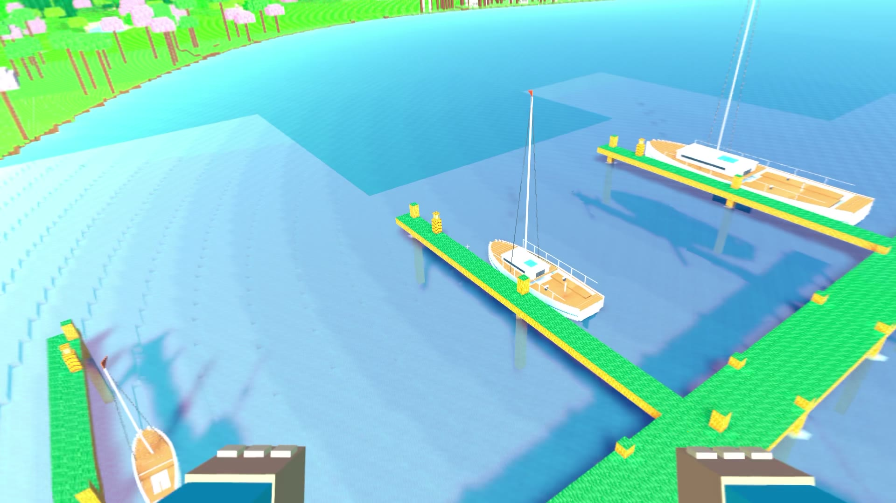
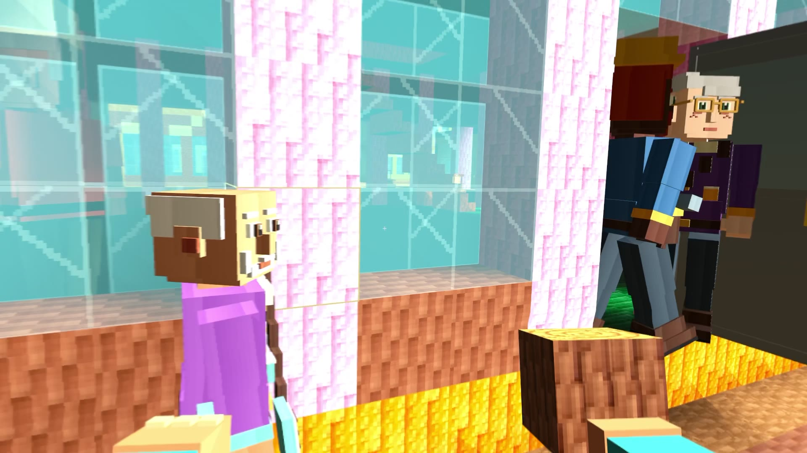

# Worldcraft

A native voxel sandbox for **Apple Vision Pro and iPad**, built with Swift, RealityKit, Metal, and SwiftUI. Explore procedural worlds, build and break blocks, meet animals and villagers, drive, sail, and travel between planets. Optional AI gives the world’s inhabitants decisions and memories.

[MIT licensed](LICENSE) · [Vision Pro setup](#apple-vision-pro) · [iPad setup](#ipad) · [Controls](#controls) · [Optional AI](#optional-ai-and-api-keys)



## Screenshots

These are actual frames from Vision Pro gameplay, not concept art. The iPad version shares the world and renderer, using a screen camera and touch-accessible menus. This is an active prototype; appearance and performance continue to change.

| Dinosaurs and forests | Marinas and sailing |
| --- | --- |
|  |  |



## What you can do

- **Explore and build:** half-metre blocks, caves, mountains, forests, oceans, rivers, changing weather, and a day/night cycle. Collect blocks and plants into a backpack and place them in the world.
- **Meet the inhabitants:** villagers, animals, dinosaurs and their young, the friendly Boomer dog, and Hay Hay companions hidden in castles. Feed animals, ride eligible creatures, and discover giant T-rexes.
- **Visit settlements:** villages, towns, cities, homes, shops, sports grounds, stadiums, roads, race tracks, and waterfront clubs.
- **Travel:** drive cars, race around circuits, sail wind-driven boats, pilot motorboats, explore space, and take rockets to other procedural worlds.
- **Make the world feel alive:** spatial sound, an original procedural soundtrack, and optional Jev/OpenRouter decisions alongside local simulation.

## Requirements

| | Apple Vision Pro | iPad |
| --- | --- | --- |
| Minimum OS | visionOS 2.0 | iPadOS 18.0 |
| Optimized scheme | `Worldcraft` | `Worldcraft iPad` |
| Debug scheme | `Worldcraft Debug` | `Worldcraft iPad Debug` |
| View | Immersive, headset-tracked | Landscape, first or third person |
| Gameplay input | Extended gamepad, or keyboard and mouse | Extended gamepad, or keyboard and mouse |

Use a Mac with **Xcode 27 or later** and the SDK for your target platform. The project has been build-checked with Xcode 27.0. A physical device is needed to judge graphics, controller behavior, spatial audio, and frame rate. M-series iPads are the initial performance testing target; there is no universal FPS guarantee.

The iPad version has touch menus and inventory, but **does not yet provide touch sticks for movement**. Neither platform requires an AI account to build or explore: without keys, characters use local behavior.

## Get the project

1. Fork this repository on GitHub, then clone your fork:

   ```sh
   git clone https://github.com/YOUR-USERNAME/worldcraft.git
   cd worldcraft
   ```

2. Open `Worldcraft.xcodeproj`. The generated Xcode project, shared schemes, textures, and audio are included; asset generation is not required to play.
3. For a physical device, sign in to your own Apple account in **Xcode → Settings → Apple Accounts**. Configure your private signing settings as described below.

### Private signing settings

Copy the example, then edit the local file with your own team ID and a unique reverse-domain bundle prefix:

```sh
cp Config/Signing.example.xcconfig Config/Signing.local.xcconfig
open -e Config/Signing.local.xcconfig
```

`DEVELOPMENT_TEAM` selects your Apple development team. `WORLDCRAFT_BUNDLE_ID_PREFIX` produces separate `.vision` and `.ipad` app identifiers. The same settings apply to both targets.

`Config/Signing.local.xcconfig` is **ignored by Git** and survives project regeneration. The public configuration includes it optionally, so a clean clone can build for Simulator without a team. Keep personal signing settings in this local file; changes made directly in Xcode’s Signing & Capabilities panel can write the team into the shared project.

Enable Developer Mode on your device when Xcode asks, pair/trust the Mac, and let Xcode manage provisioning. Simulator builds do not require signing.

### Apple Vision Pro

1. Install the visionOS platform support in **Xcode → Settings → Components**.
2. Pair your Vision Pro with Xcode and pair a gamepad or keyboard/mouse with the headset.
3. Select **Worldcraft** and your Vision Pro as the run destination, then **Run**.
4. Choose a numeric seed and select **Enter your world**. Allow world-sensing access when requested.

Your starting headset pose defines the neutral view, including when reclining. Head movement controls the tracked view; the right stick or mouse adjusts the game’s heading and pitch. Use **C / R3** to recenter. On visionOS 26+, holding the Digital Crown also triggers recalibration after the system recenter.

### iPad

1. Install iOS/iPadOS platform support in **Xcode → Settings → Components**.
2. Connect and trust an iPad, then pair a gamepad or keyboard/mouse with it.
3. Select **Worldcraft iPad** and your iPad as the run destination, then **Run**.
4. Enter a world in landscape. Use the right stick or mouse to look; **V / D-pad Down** switches first/third person.

The top-right buttons open the backpack and pause menu. **A jumps; D-pad Up opens the backpack.** The game handles controller input separately from touch buttons. Pause or open inventory to release mouse capture. **C / R3** levels the virtual camera.

## Controls

Gamepad labels use Xbox names followed by PlayStation equivalents where different.

| Action | Keyboard / mouse | Gamepad |
| --- | --- | --- |
| Move / swim | WASD | Left stick |
| Look | Mouse; Q/E and arrow keys | Right stick |
| Jump | Space | A / Cross |
| Toggle creative flight | Double-tap Space, or F | Double-tap A / Cross, or Y / Triangle on foot |
| Rise / descend | Space / Control | A / Cross; B / Circle |
| Toggle run / walk | Shift | L3 |
| First / third person | V | D-pad Down |
| Recenter / level camera | C | R3 |
| Break blocks / plants | Hold left mouse or X | Hold RT / R2 |
| Place selected item | Right mouse or Z | X / Square |
| Use, talk, feed, pet, or ride | R | LT / L2 on foot |
| Cycle hotbar | Brackets, mouse wheel, or 1–9 | LB/RB or exposed back paddles |
| Open backpack | I | D-pad Up |
| Navigate backpack | WASD / arrows, or click | D-pad / left stick |
| Select / move a stack | Enter | A / Cross |
| Equip / drop one item | R / Delete | X / Square; Y / Triangle |
| Close backpack | I / Esc | B / Circle |
| Pause / resume | Esc | Menu / Options |
| Save and leave while paused | L | B / Circle |

### Vehicles and travel

| Action | Keyboard / mouse | Gamepad |
| --- | --- | --- |
| Enter / exit a car or take a helm | R | Y / Triangle; LT can also enter on foot |
| Accelerate / brake / reverse | W / S | RT / LT |
| Steer | A / D | Left stick horizontal |
| Handbrake / drift; parking brake at rest | Space | RB / R1 |
| Car horn | — | L3 |
| Start a race at the track | E | X / Square |
| Hoist / lower sail | H | A / Cross |
| Boat anchor | Space | RB / R1 |
| Toggle automatic sail trim | T | LB / L1 |
| Manual sail trim | Brackets | Triggers |
| Choose space / rocket destination | Comma / period | D-pad Left / Right |
| Rocket door / launch control | R while aiming at the control | LT / L2 |

Sailing uses wind, currents, momentum, and automatic trim with manual override. Cars retain their driving trigger controls while seated. Actions are contextual; the HUD identifies nearby interactions.

## Optional AI and API keys

**TypeSafe Jev** handles frequent choices for villagers, wildlife, dinosaurs, and racers. **OpenRouter** supplies occasional reasoning for harder situations such as repairing a damaged home. Local simulation still enforces navigation, available actions, resources, and safety checks. Requests run outside the frame callback.

Bring your own accounts: [TypeSafe documentation](https://docs.typesafe.ai/introduction) and [OpenRouter](https://openrouter.ai/). You can use either service independently. The reasoning layer currently requests `qwen/qwen3.5-flash-02-23` and applies a local **$0.05/hour OpenRouter budget**; TypeSafe usage is separate. Provider availability and account charges depend on those services.

### Include your environment keys when building

Both app targets run `Tools/embed_build_credentials.py` during the build. It reads only:

- `TYPESAFE_API_KEY`
- `OPENROUTER_API_KEY`

It creates `BuildCredentials.plist` **inside the built app**, never inside the source directories. The phase runs every build, omits missing keys, clears stale keys and legacy credential resources, and does not print environment values.

If those variables are already exported in your terminal, use them directly. Otherwise, these **zsh** prompts keep the values out of shell history:

```sh
read -rs 'TYPESAFE_API_KEY?TypeSafe key (blank to skip): '
printf '\n'
read -rs 'OPENROUTER_API_KEY?OpenRouter key (blank to skip): '
printf '\n'
export TYPESAFE_API_KEY OPENROUTER_API_KEY
```

For the Xcode GUI, **quit Xcode first**, then launch it from that terminal:

```sh
python3 Tools/open_xcode.py
```

Opening Xcode from Finder does not inherit your terminal’s exported variables. The launcher starts Xcode directly with the current environment; it does not save keys or put them on the command line. Keys added only to a scheme’s Run environment are runtime settings, not build-time injection.

For a command-line build, `xcodebuild` inherits your shell environment:

```sh
xcodebuild -project Worldcraft.xcodeproj -scheme 'Worldcraft iPad' \
  -configuration Release -destination 'generic/platform=iOS' \
  -derivedDataPath tmp/iPadBuild CODE_SIGNING_ALLOWED=NO build
```

Use the `Worldcraft` scheme and `generic/platform=visionOS` for Vision Pro. These unsigned commands check compilation; use Xcode with your own signing settings to install on hardware.

### Enter keys on the device instead

The lobby and pause settings offer **Connect TypeSafe** and **Connect OpenRouter**. Device-entered keys are stored in Keychain, outside world saves. Lookup order is runtime environment, then device Keychain, then the build-generated resource. You can disable either AI layer in settings.

**Embedded keys can be extracted from an app binary.** Use them for your own builds. Before distributing an `.app`, `.ipa`, or archive, unset both variables and rebuild, and let each player enter their own keys. Source releases must not contain keys, personal signing files, build products, or developer-team identifiers.

## Saves and performance

World saves are local to each app/device under Application Support at `Worldcraft/world-v1.json`; cloud sync is not implemented. The active world seed, edits, inventory, characters, and visited-world progress persist. Starting another seed replaces the active save. Generation changes during development can change old terrain around saved edits.

Use the optimized schemes for playing and performance measurement. Draw distance and detail distance are configurable in the lobby and pause settings. Device model, scene complexity, and thermal state affect performance. `WORLDCRAFT_PERF` reports update cadence and individual CPU/GPU work; **update Hz is not presented FPS**. Measure actual frames with Xcode’s profiling tools on the target device.

For startup problems, include `WORLDCRAFT_STARTUP` lines with an issue. A Simulator boot/XPC error before the app launches is a Simulator service problem; first quit Xcode and Device Hub/Simulator and retry, or restart the Mac. [Apple’s device setup guide](https://developer.apple.com/documentation/xcode/managing-your-simulated-and-physical-devices-in-device-hub) covers simulator and hardware destinations.

## Development

| Location | Purpose |
| --- | --- |
| `Sources/WorldCore/` | Procedural generation, voxel geometry, physics, navigation, and shared game rules |
| `App/` | Platform entry points, views, renderer, audio, input, and actor-based simulation |
| `Tests/` | Engine, simulation, and controller tests |
| `Resources/` | Included game textures, materials, icons, music, and effects |
| `Tools/` | Asset generators, benchmarks, build helpers, and publication checks |
| `project.yml` | Source of truth for the generated Xcode project |

Run the shared tests on macOS:

```sh
swift test -c release
python3 -m unittest discover -s Tools/tests -v
```

The Xcode project is generated using [XcodeGen](https://github.com/yonaskolb/XcodeGen). If you add source files or change build settings, regenerate it:

```sh
brew install xcodegen
xcodegen generate
```

Make persistent shared configuration changes in `project.yml` and personal signing changes in `Config/Signing.local.xcconfig`. Commit the regenerated project and shared schemes together with source changes.

Asset generators use Python and Swift; audio mastering also uses `ffmpeg`. They are optional for playing. For example, `python3 Tools/generate_assets.py --visuals-only` regenerates visual assets, and `python3 Tools/validate_assets.py` checks them. `python3 Tools/validate_audio.py` checks the audio library. Game textures and audio are original; Minecraft assets and recordings are not included.

### Before publishing changes

```sh
python3 Tools/check_publication.py
git status --short
```

The audit checks publishable files and **all local Git objects**, including staged/dangling objects, for known environment keys, API token patterns, literal API-key assignments, and Apple team identifiers. It also flags private/generated files and files above GitHub’s size limit. The check reports locations without printing secret values. Keep your key variables exported while auditing so exact-value matching can check them too.

`.gitignore` excludes local credentials/signing settings, Xcode user state, build products, caches, recordings/previews in `output/`, and scratch work in `tmp/`. It intentionally keeps the project, shared schemes, code, game assets, and screenshots. Review files before committing; an ignore rule does not remove something already committed. If a credential was ever pushed, revoke it and clean the affected remote history as well.

Bug reports are most useful with the platform, device/OS, seed, location, reproduction steps, and relevant game logs. Remove credentials and personal account details before sharing diagnostics.

## License

Worldcraft’s code, original game assets, and documentation are available under the [MIT License](LICENSE). Apple SDKs and optional external AI services have their own terms. Worldcraft is an independent project and is not affiliated with Minecraft, Mojang, or Microsoft.
